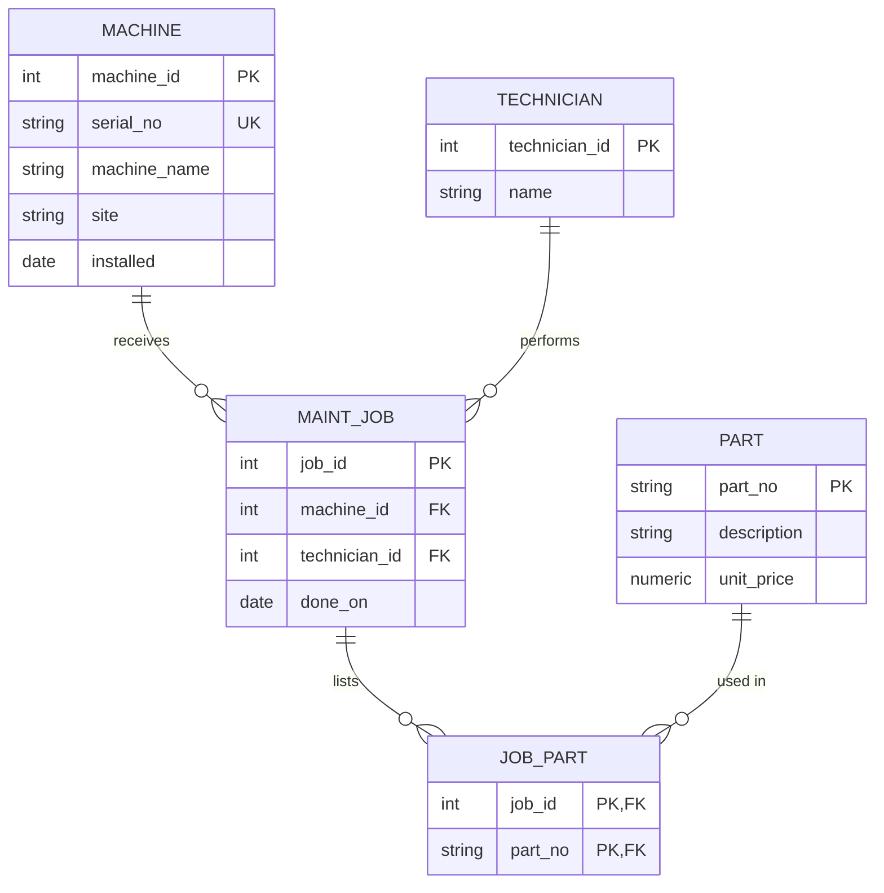

# Module 02: ER audit of legacy.db

## 1. Entities, attributes, intended keys

| Entity | Attributes in legacy schema | Intended primary key | Problem |
|---|---|---|---|
| Machine | machine_name, serial_no, site, installed | serial_no (natural) | No PK declared; installed is free text |
| Part | part_no, description, unit_price | part_no (natural) | No UNIQUE (P-1003 twice); price stored as text |
| MaintenanceJob | job_id, machine_name, technician, done_on, parts_used | job_id | No PK declared; machine and technician are text, parts_used is a list |
| Technician | only the text column `technician` in maint_job | none (name only) | Hidden entity; needs its own table and key |
| JobPart | does not exist (hidden in `parts_used`) | (job_id, part_no) | Missing junction table |

## 2. Reconstructed ER diagram (what the designer should have modeled)

Reading the diagram:
- One machine has zero or many jobs; each job belongs to exactly one machine.
- One technician performs zero or many jobs; each job is done by exactly one technician.
- A job lists zero or many parts and a part appears in zero or many jobs (m:n, resolved by `JOB_PART`).
- The composite key (job_id, part_no) means a part can be listed only once per job.

## 3. Cardinality findings (from counts, see cardinality-output.txt)

| Query | Result | What it proves |
|---|---|---|
| n_parts per job | job 1 = 2, jobs 2 and 3 = 1, job 4 = NULL | A job can use several parts, so the list in `parts_used` is a hidden m:n |
| jobs per machine_name | cnc-01 = 2, cnc-02 = 1, cnc-05 = 1 | One machine has many jobs (1:n); cnc-05 is an orphan |
| jobs per technician | Beier = 2, Klaas = 1, Werther = 1 | One technician does many jobs (1:n) |
| machine rows vs distinct serial_no | 4 rows, 4 distinct | serial_no is unique in the data, but not enforced |

## 4. What the legacy schema models and what it hides

- **1:1:** Not modeled. The "nameplate" is just the `serial_no` attribute of machine, which is acceptable because it has no other attributes of its own.
- **1:n:** Hidden. Machine → jobs and technician → jobs exist only as matching text values (`machine_name`, `technician`), with no foreign keys, so cnc-05 slipped in.
- **m:n:** Hidden inside the comma-separated `parts_used` column, with no junction table, which violates 1NF.