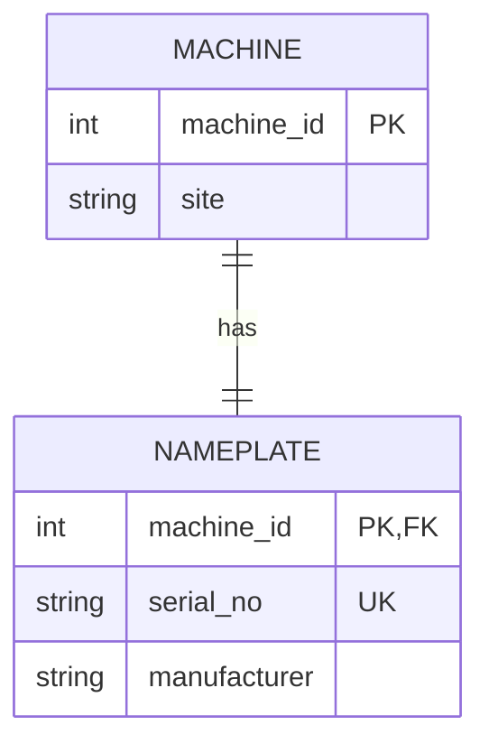
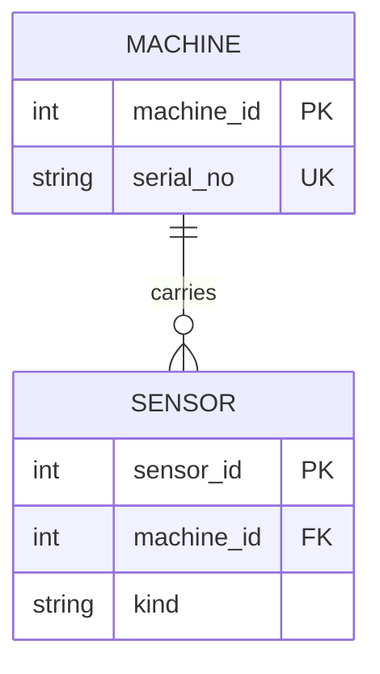
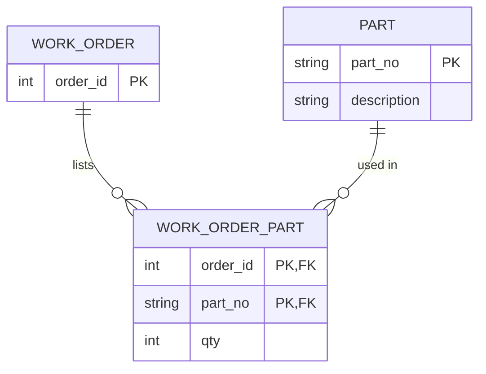
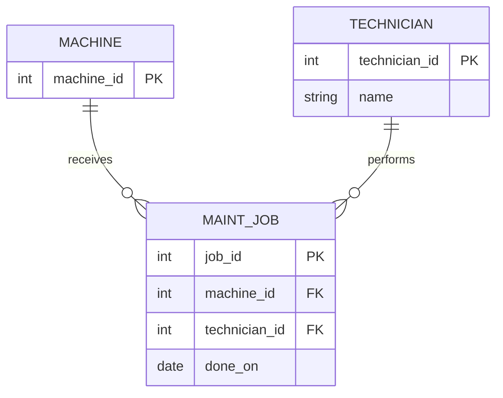

# Task B: From words to sketch

## 1. One-to-one: machine and nameplate

- **Where does the key go?** The foreign key can sit on either side. Here `nameplate.machine_id` is both primary key and foreign key, so a machine can have at most one nameplate. If it were only a plain foreign key, it would need `UNIQUE`.
- **Entity or attribute?** Both work. Since the nameplate has only two attributes and no life of its own, I would fold it into `machine` as the columns `serial_no` and `manufacturer`. A separate table makes sense only if the nameplate is replaced, has its own history, or is optional.

## 2. One-to-many: machine and sensors

- **Which side holds the foreign key?** The "many" side: `sensor.machine_id`. Each sensor row points to exactly one machine, while a machine row cannot hold a list of sensors.

## 3. Many-to-many: work orders and parts

- **What extra table?** A junction table, `work_order_part`.
- **What is its key?** The composite key `(order_id, part_no)`. Because the pair must be unique, an order can list a given part only once. `qty` is an attribute of the relationship.

## 4. Entity, attribute or relationship: maintenance jobs

- **Is the job a relationship or an entity?** An entity. It links a machine and a technician, but it has its own identity (`job_id`) and its own attribute (`done_on`), and other tables such as `job_part` refer to it.
- **Is the technician an entity or just a name?** An entity. One person performs many jobs, so a name repeated as text invites typos (`Beier` / `beier`). A technician table gives one row per person and a foreign key from the job.

## Proof: 1:n (machine to sensors)

See `proof_sensor.sql` and `proof_output.txt`. The result is below (paste the real output).